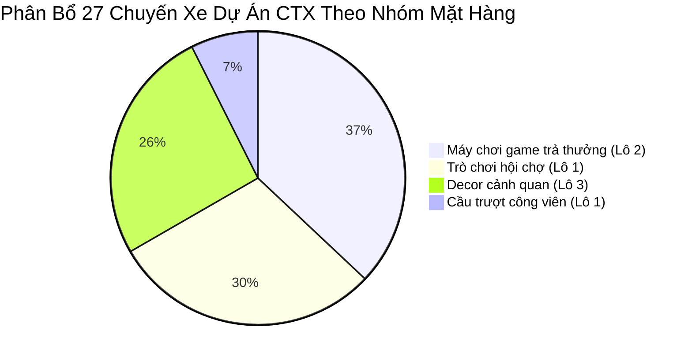
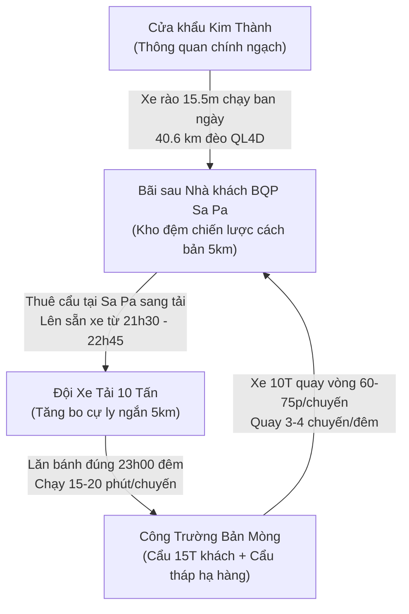

# TÀI LIỆU KẾ HOẠCH VẬN TẢI & PHƯƠNG ÁN ĐIỀU PHỐI LOGISTICS DỰ ÁN CTX
## Tuyến Vận Tải: Cửa Khẩu Kim Thành (Lào Cai) ➔ Sa Pa ➔ Bản Mòng
**Đơn vị lập:** Ban Điều hành Vận tải - Công ty TNHH DPT VINA HOLDINGS (Kỳ Tốc Logistics)  
**Khách hàng:** Tổng Công Ty Cổ Phần Đầu Tư Xây Dựng Và Thương Mại Việt Nam (CTX)  
**Hồ sơ tham chiếu:** [Báo giá đường bộ PDF](file:///c:/Users/Admin/Desktop/CTX/B%C3%A1o%20gi%C3%A1%20CTX-%20K%E1%BB%B3%20T%E1%BB%91c%20%C4%91%C6%B0%E1%BB%9Dng%20b%E1%BB%99.pdf) | [Kế hoạch điều phối Excel](file:///c:/Users/Admin/Desktop/CTX/Ke-Hoach-Dieu-Phoi-Van-Tai-Lao-Cai-Ban-Mong-CTX.xlsx) | [Bảng điều phối chi tiết CSV](file:///c:/Users/Admin/Desktop/CTX/D%E1%BB%B1%20%C3%A1n%20CTX%20-%20%C4%90i%E1%BB%81u%20ph%E1%BB%91i%20chi%20ti%E1%BA%BFt.csv)

---

# TRANG 1: THÔNG TIN DỰ ÁN & INSIGHT KHẢO SÁT HIỆN TRƯỜNG

## 1. Thông Tin Tổng Quan Dự Án

* **Tên dự án:** Vận chuyển, thông quan và điều phối thiết bị khu vui chơi giải trí cao cấp CTX Sa Pa.
* **Chủ đầu tư / Khách hàng:** Tổng Công Ty Cổ Phần Đầu Tư Xây Dựng Và Thương Mại Việt Nam (CTX).
* **Đơn vị thực hiện logistics:** Công ty TNHH DPT VINA HOLDINGS (Kỳ Tốc Logistics - Hotline: `0904.066.068` - Website: `www.kytoc.vn`).
* **Tổng chi phí ước tính (Báo giá dịch vụ):** **2.874.640.000 VNĐ** *(Hai tỷ tám trăm bảy mươi tư triệu sáu trăm bốn mươi nghìn đồng)*.
* **Tổng khối lượng hàng hóa dự kiến:** **2.405 M³** (Tương đương 37 Container 40HC, được tối ưu hóa sang đóng **27 xe rào 13m7 / 15m5**).
* **Tổng số kiện hàng:** **~ 450 – 500 kiện** (Lô 2 máy game trả thưởng và trò chơi hội chợ: 201 kiện; Lô 3 Decor: 63 kiện; Lô 1 cầu trượt & thiết bị công viên ngoài trời).
* **Tổng số chuyến xe vận chuyển:** **27 chuyến xe tải rào chuyên dụng** (Lô 1: 10 xe, Lô 2: 10 xe, Lô 3: 7 xe).
* **Cơ cấu mặt hàng chuyên chở:**
  1. *Cầu trượt công viên:* 02 xe (Xuất phát từ Nam Kinh - Nanjing).
  2. *Trò chơi hội chợ:* 08 xe (Xuất phát từ Trung Sơn - Zhongshan).
  3. *Máy chơi game trả thưởng điện tử & Bảng LED:* 10 xe (Xuất phát từ Trung Sơn & Panyu).
  4. *Thiết bị Decor cảnh quan:* 07 xe (Xuất phát từ Trung Sơn).

---

## 2. Thủ Tục Xuất Nhập Khẩu (XNK) & Pháp Lý Chuyên Ngành

* **Pháp nhân nhập khẩu:** **Công ty Indochina** nhận ủy thác nhập khẩu từ **Tổng Công Ty Cổ Phần Đầu Tư Xây Dựng Và Thương Mại Việt Nam (CTX)** để đứng tên trên toàn bộ tờ khai hải quan. Tiền hàng thanh toán quốc tế chuyển trực tiếp từ **CTX sang UNIS (Trung Quốc)**.
* **Cửa khẩu thông quan:** Cửa khẩu Quốc tế đường bộ Kim Thành, thành phố Lào Cai, tỉnh Lào Cai.
* **Thủ tục chuyên ngành đặc thù cho Lô 2 (Máy chơi game trả thưởng):**
  - **Cơ quan cấp phép & kiểm tra:** Sở Văn hóa, Thể thao và Du lịch tỉnh Lào Cai.
  - **Thời gian xin giấy phép nhập khẩu:** **10 – 15 ngày làm việc** (Hạn chót phải hoàn thành chậm nhất trước ngày **15/11/2026** để không ảnh hưởng đến ngày lăn bánh 06/12/2026).
  - **Thẩm định nội dung tại công trình:** Sau khi thông quan, hàng được đưa về lưu tại công trình Bản Mòng và tiến hành lắp ráp các model mẫu để Hội đồng thẩm định Sở Văn hóa kiểm tra thực tế (Thời gian thẩm định: **30 ngày làm việc**).
  - **Tiêu chuẩn kiểm soát nội dung nghiêm ngặt:**
    - Tuyệt đối không chứa hình ảnh bản đồ có "đường lưỡi bò".
    - Không vi phạm bản quyền nhân vật hoạt hình/người nổi tiếng đã được bảo hộ.
    - Không có hình ảnh bạo lực, đồi trụy; âm nhạc không vi phạm bản quyền.
    - Tất cả các máy game tuyệt đối **không có tính năng đổi thưởng ra tiền mặt**.
    - Phải niêm yết công khai bảng trả thưởng điểm số theo quy định pháp luật.
    - Công ty Indochina phải cung cấp đầy đủ giấy phép lắp đặt và vận hành thiết bị trò chơi điện tử.

---

## 3. Thông Tin Khảo Sát Hiện Trường Tuyến Đường & Các "Insight" Then Chốt

Đội khảo sát thực địa Kỳ Tốc Logistics đã trực tiếp đo đạc cung đường và ghi nhận các điều kiện vận hành thực tế:

* **Tuyến đường vận chuyển:**
  - *Chặng quốc tế:* Nhà máy tại Thượng Hải / Quảng Châu ➔ Cửa khẩu Hà Khẩu (Trung Quốc) ➔ Cửa khẩu Kim Thành (Lào Cai).
  - *Chặng nội địa (45.6 km):* Cửa khẩu Kim Thành ➔ QL4D leo đèo Hoàng Liên Sơn (**40.6 km**) ➔ Thị xã Sa Pa ➔ Đường bê tông dốc núi vào Bản Mòng (**5.0 km**). Xem [Bản đồ vệ tinh lộ trình](file:///c:/Users/Admin/Desktop/CTX/hinh-anh/B%E1%BA%A3n%20%C4%91%E1%BB%93/Annotation%202026-10-31%20122137.jpg).
* **Insight 1: Quy định cấm xe & tải trọng chặng cuối:**
  - Căn cứ biển báo giao thông thực tế chụp tại **số 042 Thạch Sơn, Sa Pa** (xem [Ảnh biển cấm 4798](file:///c:/Users/Admin/Desktop/CTX/hinh-anh/%E1%BA%A2nh%20c%E1%BA%A5m%20%C4%91%C6%B0%E1%BB%9Dng/1793411900628_5150800829646320375_g3794004449775197483_479863bde70bbc361f4aa830079a309e.jpg)): Sa Pa cấm tất cả xe tải có tổng trọng tải trên **10 Tấn** và xe khách trên **29 chỗ**.
  - Tuyến dốc bê tông từ thị xã xuống Bản Mòng cua dốc tay áo rất gắt, xe container 40ft và xe rào 15.5m **tuyệt đối không thể di chuyển vào**, bắt buộc phải sang tải sang xe 10 Tấn.
* **Insight 2: Giờ cấm đường & Khung giờ giao hàng ban đêm:**
  - Thị xã Sa Pa cấm xe tải lưu thông ban ngày từ **06:00 đến 23:00** hàng ngày.
  - Các ngày cuối tuần (Thứ 7 & Chủ Nhật) cấm tuyệt đối ban ngày để phục vụ khách du lịch.
  - **Khung giờ giao hàng cho phép duy nhất:** Chỉ được chạy ban đêm từ **23:00 đến 06:00 sáng hôm sau** (khung 7 tiếng ca đêm, từ đêm Thứ 2 đến đêm Thứ 5 / rạng sáng Thứ 6).
* **Insight 3: Ưu tiên tiến độ đặc biệt - Shipment 3 (Lô Decor) cần trước:**
  - Chủ thầu dự án yêu cầu điều phối **Shipment 3 (Decor cảnh quan công viên)** cần tập kết hàng sớm hoặc đi song song/cuốn chiếu để đội ngũ thi công hoàn thiện hạ tầng, cảnh quan và phần thô trước khi đưa các máy game và thiết bị điện tử vào lắp ráp trong nhà.

---

# TRANG 2: PHƯƠNG ÁN VẬN CHUYỂN, THÔNG QUAN, TIẾN ĐỘ & BÁO GIÁ

## 1. Thông Tin Phương Án Vận Chuyển

* **Hình thức:** Vận tải đường bộ liên vận quốc tế kết hợp trung chuyển nội địa vùng cao.
* **Phương tiện chặng quốc tế & chặng chính:** 
  - Pick-up tận xưởng Trung Quốc đóng trên **xe tải rào 13m7** (dung tích thùng 80 – 85 M³).
  - Về đến cửa khẩu Việt Nam chuyển sang **xe tải rào / đầu kéo 15m5** chạy tuyến chính vượt 40.6km đèo QL4D lên Sa Pa vào ban ngày (tầm nhìn thoáng, an toàn tối đa).
* **Phương thức trung chuyển chặng cuối (Last-mile):**
  - Xe 15.5m tập kết tại bãi đất trống phía sau **Nhà khách Bộ Quốc Phòng (BQP) Sa Pa** (cách Bản Mòng 5km).
  - Bãi BQP đóng vai trò kho đệm chiến lược: Thuê 01 xe cẩu tự hành tại Sa Pa sang tải từ xe 15.5m sang **đội xe tải 10 Tấn**.
  - Đội xe 10 Tấn tăng bo cự ly ngắn 5km vào Bản Mòng trong khung giờ đêm được phép chạy (23:00 - 06:00).

---

## 2. Phương Án Thông Quan & Kiểm Hóa Cửa Khẩu

* Khai báo hải quan điện tử truyền tờ khai từ xa trước khi hàng cập biên giới.
* Hàng hóa thông quan chính ngạch qua **Chi cục Hải quan Cửa khẩu Kim Thành (Lào Cai)**.
* Niêm phong kẹp chì nguyên vẹn từ xưởng Trung Quốc đến bãi kiểm hóa. Trường hợp luồng đỏ, phối hợp kiểm hóa nhanh tại bãi kho mái che Kim Thành Logistics để giải phóng xe trong vòng 24 giờ.

---

## 3. Thời Gian Thực Hiện Dự Kiến

| Chặng Vận Chuyển / Nghiệp Vụ | Thời Gian Tiêu Chuẩn (Không Kiểm Hóa) | Thời Gian Phát Sinh Kiểm Hóa Luồng Đỏ |
| :--- | :---: | :---: |
| **Tuyến Thượng Hải ➔ Sa Pa** | **7 – 9 ngày / xe** | Cộng thêm 3 – 4 ngày (kiểm TQ) + 1 – 2 ngày (kiểm VN) |
| **Tuyến Quảng Đông ➔ Sa Pa** | **4 – 6 ngày / xe** | Cộng thêm 3 – 4 ngày (kiểm TQ) + 1 – 2 ngày (kiểm VN) |
| **Xin giấy phép NK Sở Văn hóa** | **10 – 15 ngày làm việc** | Bắt buộc hoàn tất trước 15/11/2026 |
| **Thẩm định model máy tại dự án** | **30 ngày làm việc** | Diễn ra song song quá trình lắp đặt |

---

## 4. Báo Giá Dự Kiến & Các Chi Phí Phát Sinh

### 4.1. Bảng Kê Chi Phí Dịch Vụ Vận Chuyển Trọn Gói (Căn cứ Báo giá ngày 19/09/2026)

| STT | Hạng Mục Chi Phí | Số Lượng | Đơn Giá (VNĐ) | Thành Tiền (VNĐ) |
| :---: | :--- | :---: | :---: | :---: |
| 1 | Cước vận chuyển đường bộ Shanghai – Lào Cai | 02 xe | 92.120.000 | 184.240.000 |
| 2 | Cước vận chuyển đường bộ Quảng Đông – Lào Cai | 25 xe | 64.842.000 | 1.621.050.000 |
| 3 | Cước vận chuyển tăng bo Lào Cai – Bản Mòng | 27 xe | 10.000.000 | 270.000.000 |
| 4 | Chi phí khai báo hải quan 2 đầu (TQ & VN) | 27 xe | 24.050.000 | 649.350.000 |
| 5 | Chi phí dịch vụ xin giấy phép NK & Thẩm định văn hóa | 01 gói | 150.000.000 | 150.000.000 |
| **TỔNG**| **TỔNG CHI PHÍ ƯỚC TÍNH (CHƯA VAT)** | **27 Xe** | | **2.874.640.000 VNĐ** |

### 4.2. Các Khoản Chi Phí Phát Sinh Dự Kiến Cần Kiểm Soát:
* **Chi phí kiểm hóa tại Cửa khẩu Kim Thành (Lào Cai):** `5.000.000 VNĐ / xe` (chỉ thu khi tờ khai rơi vào luồng đỏ thực tế).
* **Chi phí kiểm hóa tại Cửa khẩu Hà Khẩu (Trung Quốc):** `4.500 Tệ / xe` (~ 16.200.000 VNĐ/xe).
* **Chi phí lưu ca xe đầu Trung Quốc:** `500 Tệ / xe / ngày` (áp dụng từ ngày thứ 3 kể từ khi xe đến cửa khẩu Hà Khẩu nếu chậm thông quan).
* **Chi phí phát sinh ở bãi nếu hạ hàng lưu đệm tại Sa Pa:**
  - *Trường hợp sang tải trực tiếp từ xe 15.5m sang xe 10T:* Không phát sinh phí lưu bãi.
  - *Trường hợp hạ hàng xuống bãi trung chuyển BQP Sa Pa:* Dự kiến phát sinh phí sử dụng mặt bằng và lưu bãi tạm thời theo biểu phí của Ban quản lý Nhà khách Bộ Quốc Phòng (`1.000.000 - 1.500.000 VNĐ/lô`).
* **Hạn mức dự phòng lưu ca & kiểm hóa:** Đã được Kỳ Tốc dự toán quản trị trong kế hoạch điều phối chi tiết là **38.000.000 VNĐ**.
* **Phạm vi loại trừ:** Giá chưa bao gồm thuế VAT và chi phí bốc vác thủ công vào từng phòng/tầng lắp đặt.

---

# TRANG 3: PHƯƠNG ÁN ĐIỀU PHỐI CHI TIẾT (ÁP DỤNG DUY NHẤT PHƯƠNG ÁN 2)

## 1. Bảng Kế Hoạch Điều Phối Chi Tiết 27 Chuyến Xe Về Bản Mòng

Toàn bộ 27 chuyến xe được số hóa theo dõi tiến độ từ ngày **04/12/2026** đến **23/12/2026**:

| Lô | Mã Xe | Mặt Hàng Chi Tiết | Nơi Xuất (POL) | Điểm Đến (POD) | ETD (Ngày Đi) | ETA (Ngày Đến) | Dự Toán Phí Lưu Ca / Kiểm Hóa | Pháp Nhân Mở Tờ Khai | Bản Vẽ Xếp Xe 3D/2D | Ghi Chú Tiến Độ Khai Thác |
| :---: | :---: | :--- | :--- | :---: | :---: | :---: | :---: | :--- | :---: | :--- |
| **Lô 1** | Xe 1.1 | Cầu trượt | 南京 - Nam Kinh | Sa Pa | 04/12 | 10/12 | 5.000.000 | CTX | - | Hạn chót ETA 15/12 để kịp lắp đặt |
| | Xe 1.2 | Cầu trượt | 南京 - Nam Kinh | Sa Pa | 04/12 | 10/12 | 0 | CTX | - | Hạn chót ETA 15/12 |
| | Xe 1.3 | Trò chơi hội chợ | 中山 - Trung Sơn | Sa Pa | 12/12 | 16/12 | 0 | CTX | - | Chạy đêm 23h - 06h |
| | Xe 1.4 | Trò chơi hội chợ | 中山 - Trung Sơn | Sa Pa | 12/12 | 16/12 | 0 | CTX | - | Chạy đêm 23h - 06h |
| | Xe 1.5 | Trò chơi hội chợ | 中山 - Trung Sơn | Sa Pa | 13/12 | 17/12 | 0 | CTX | - | Chạy đêm 23h - 06h |
| | Xe 1.6 | Trò chơi hội chợ | 中山 - Trung Sơn | Sa Pa | 13/12 | 17/12 | 0 | CTX | - | Chạy đêm 23h - 06h |
| | Xe 1.7 | Trò chơi hội chợ | 中山 - Trung Sơn | Sa Pa | 14/12 | 18/12 | 0 | CTX | - | Chạy đêm 23h - 06h |
| | Xe 1.8 | Trò chơi hội chợ | 中山 - Trung Sơn | Sa Pa | 14/12 | 18/12 | 0 | CTX | - | Chạy đêm 23h - 06h |
| | Xe 1.9 | Trò chơi hội chợ | 中山 - Trung Sơn | Sa Pa | 15/12 | 19/12 | 0 | CTX | - | Chạy đêm 23h - 06h |
| | Xe 1.10| Trò chơi hội chợ | 中山 - Trung Sơn | Sa Pa | 15/12 | 19/12 | 0 | CTX | - | Chạy đêm 23h - 06h |
| **Lô 2** | Xe 2.1 | Máy chơi game trả thưởng | 中山 - Trung Sơn | Sa Pa | 06/12 | 11/12 | 5.000.000 | Indochina (Ủy thác CTX) | [Bản vẽ Xe 1](file:///c:/Users/Admin/Desktop/CTX/Ban-ve-xep-xe-PL73786303__xe1__tq_13m_rao.html) | Giấy phép trước 15/11 • Tăng bo 3 xe/ngày |
| | Xe 2.2 | Máy chơi game trả thưởng | 中山 - Trung Sơn | Sa Pa | 06/12 | 11/12 | 0 | Indochina (Ủy thác CTX) | [Bản vẽ Xe 2](file:///c:/Users/Admin/Desktop/CTX/Ban-ve-xep-xe-PL73786303__xe2__tq_13m_rao.html) | Giấy phép trước 15/11 • Tăng bo 3 xe/ngày |
| | Xe 2.3 | Máy chơi game trả thưởng | 中山 - Trung Sơn | Sa Pa | 06/12 | 11/12 | 0 | Indochina (Ủy thác CTX) | [Bản vẽ Xe 3](file:///c:/Users/Admin/Desktop/CTX/Ban-ve-xep-xe-PL73786303__xe3__tq_13m_rao.html) | Giấy phép trước 15/11 • Tăng bo 3 xe/ngày |
| | Xe 2.4 | Máy chơi game trả thưởng | 中山 - Trung Sơn | Sa Pa | 06/12 | 12/12 | 2.000.000 | Indochina (Ủy thác CTX) | [Bản vẽ Xe 4](file:///c:/Users/Admin/Desktop/CTX/Ban-ve-xep-xe-PL73786303__xe4__tq_13m_rao.html) | Giấy phép trước 15/11 • Tăng bo 3 xe/ngày |
| | Xe 2.5 | Máy chơi game trả thưởng | 中山 - Trung Sơn | Sa Pa | 06/12 | 12/12 | 2.000.000 | Indochina (Ủy thác CTX) | [Bản vẽ Xe 5](file:///c:/Users/Admin/Desktop/CTX/Ban-ve-xep-xe-PL73786303__xe5__tq_13m_rao.html) | Giấy phép trước 15/11 • Tăng bo 3 xe/ngày |
| | Xe 2.6 | Máy chơi game trả thưởng | 中山 - Trung Sơn | Sa Pa | 06/12 | 13/12 | 4.000.000 | Indochina (Ủy thác CTX) | [Bản vẽ Xe 6](file:///c:/Users/Admin/Desktop/CTX/Ban-ve-xep-xe-PL73786303__xe6__tq_13m_rao.html) | Giấy phép trước 15/11 • Tăng bo 3 xe/ngày |
| | Xe 2.7 | Máy chơi game trả thưởng | 番禺 - Panyu | Sa Pa | 06/12 | 13/12 | 4.000.000 | Indochina (Ủy thác CTX) | [Bản vẽ Xe 7](file:///c:/Users/Admin/Desktop/CTX/Ban-ve-xep-xe-PL73786303__xe7__tq_13m_rao.html) | Giấy phép trước 15/11 • Tăng bo 3 xe/ngày |
| | Xe 2.8 | Máy chơi game trả thưởng | 番禺 - Panyu | Sa Pa | 06/12 | 13/12 | 4.000.000 | Indochina (Ủy thác CTX) | [Bản vẽ Xe 8](file:///c:/Users/Admin/Desktop/CTX/Ban-ve-xep-xe-PL73786303__xe8__tq_13m_rao.html) | Giấy phép trước 15/11 • Tăng bo 3 xe/ngày |
| | Xe 2.9 | Máy chơi game trả thưởng | 番禺 - Panyu | Sa Pa | 06/12 | 14/12 | 6.000.000 | Indochina (Ủy thác CTX) | [Bản vẽ Xe 9](file:///c:/Users/Admin/Desktop/CTX/Ban-ve-xep-xe-PL73786303__xe9__tq_13m_rao.html) | Giấy phép trước 15/11 • Tăng bo 3 xe/ngày |
| | Xe 2.10| Máy chơi game trả thưởng | 番禺 - Panyu | Sa Pa | 06/12 | 14/12 | 6.000.000 | Indochina (Ủy thác CTX) | [Bản vẽ Xe 10](file:///c:/Users/Admin/Desktop/CTX/Ban-ve-xep-xe-PL73786303__xe10__tq_13m_rao.html)| Giấy phép trước 15/11 • Tăng bo 3 xe/ngày |
| **Lô 3** | Xe 3.1 | Thiết bị Decor cảnh quan | 中山 - Trung Sơn | Sa Pa | 16/12 | 20/12 | 0 | CTX | - | Cần trước để hoàn thiện hạ tầng |
| | Xe 3.2 | Thiết bị Decor cảnh quan | 中山 - Trung Sơn | Sa Pa | 16/12 | 20/12 | 0 | CTX | - | Cần trước để hoàn thiện hạ tầng |
| | Xe 3.3 | Thiết bị Decor cảnh quan | 中山 - Trung Sơn | Sa Pa | 17/12 | 21/12 | 0 | CTX | - | Chạy đêm 23h - 06h |
| | Xe 3.4 | Thiết bị Decor cảnh quan | 中山 - Trung Sơn | Sa Pa | 17/12 | 21/12 | 0 | CTX | - | Chạy đêm 23h - 06h |
| | Xe 3.5 | Thiết bị Decor cảnh quan | 中山 - Trung Sơn | Sa Pa | 18/12 | 22/12 | 0 | CTX | - | Chạy đêm 23h - 06h |
| | Xe 3.6 | Thiết bị Decor cảnh quan | 中山 - Trung Sơn | Sa Pa | 18/12 | 22/12 | 0 | CTX | - | Chạy đêm 23h - 06h |
| | Xe 3.7 | Thiết bị Decor cảnh quan | 中山 - Trung Sơn | Sa Pa | 19/12 | 23/12 | 0 | CTX | - | Chuyến cuối hoàn tất bàn giao dự án |
| **TỔNG**| **27 Xe**| | | | | | **38.000.000 VNĐ**| | | |

---

## 2. Kế Hoạch Vận Hành Độc Quyền Theo PHƯƠNG ÁN 2 (Khuyến Nghị Duy Nhất)

Kế hoạch loại bỏ hoàn toàn Phương án 1 (sang tải Kim Thành chạy đèo 45km) để dồn 100% nguồn lực triển khai **Phương Án 2**:

### Lịch Trình Tác Nghiệp Ca Đêm Chi Tiết (23:00 ➔ 06:00):
* **08:00 – 17:00 (Ban ngày):** Xe tải 15.5m chở hàng leo đèo QL4D lên Sa Pa an toàn, vào bãi Nhà khách Bộ Quốc Phòng quay đầu và đỗ hạ hàng.
* **21:30 – 22:45:** Xe cẩu tự hành tại Sa Pa sang tải trước lên thùng 02 xe tải 10 Tấn, chằng buộc tăng đơ và phủ bạt dù chống sương mù.
* **23:00 (Mở khung giờ xe tải nội thị):** 02 xe 10T xuất phát từ bãi BQP, di chuyển 5km qua thị xã xuống dốc Bản Mòng (chỉ mất **15 – 20 phút**).
* **23:20 – 23:55:** Xe cẩu 15 Tấn của khách hàng và cẩu tháp dự án CTX phối hợp hạ hàng vào vị trí thi công.
* **00:00 – 04:30:** Xe 10T quay đầu về bãi BQP nhận chuyến 2, chuyến 3, chuyến 4 (đạt năng suất 3-4 chuyến/đêm).
* **04:45 – 05:30:** Kết thúc bốc dỡ toàn bộ hàng trong ca, nghiệm thu biên bản bàn giao.
* **Trước 05:45:** Toàn bộ xe tải 10T rút khỏi các tuyến phố Sa Pa về bãi đỗ an toàn, tuyệt đối không vi phạm mốc giờ cấm 06:00 sáng.

---

# TRANG 4: THÔNG TIN CẦN CHỦ THẦU / KHÁCH HÀNG CHUẨN BỊ ĐỂ NHẬN HÀNG

Để đảm bảo quy trình giao nhận 27 chuyến xe diễn ra thông suốt, an toàn tuyệt đối và đúng tiến độ cam kết, **Tổng thầu / Khách hàng (CTX)** cần phối hợp chuẩn bị các hạng mục sau:

## 1. Tiêu Chuẩn Phương Tiện & Năng Suất Tiếp Nhận

* **Quy cách phương tiện chặng chính:**
  - Đầu Trung Quốc: **Xe tải rào 13m7** (dung tích 80 – 85 M³).
  - Đầu Việt Nam: **Xe tải rào / Sơ mi rơ moóc 15m5**.
* **Năng suất khai thác & tiếp nhận tại công trường:**
  - Định mức tiếp nhận: **2 – 3 xe container 15.5m / ngày** (tương đương 6 – 9 chuyến xe 10T tăng bo trong ca đêm).

---

## 2. Thiết Bị & Phương Tiện Yêu Cầu Khách Hàng Chuẩn Bị Trước

Chủ thầu cần bố trí sẵn sàng các nguồn lực kỹ thuật tại hai đầu bãi:

1. **01 Xe cẩu tại bãi nhận hàng:** Trực tại bãi trung chuyển phía sau Nhà khách Bộ Quốc Phòng Sa Pa để phục vụ bốc dỡ từ xe 15.5m sang xe 10T (Kỳ Tốc hỗ trợ đặt lịch xe cẩu Sa Pa, khách hàng phê duyệt chi phí).
2. **01 Xe cẩu tại bãi hạ hàng:** Trực sẵn 24/24 tại chân công trình Bản Mòng (**Xe cẩu tự hành 15 Tấn của khách hàng** kết hợp với **cần cẩu tháp hiện trường của dự án CTX**).
3. **03 Xe tải tăng bo chuyên dụng:** Đội xe tải có tổng trọng tải **dưới 10 Tấn** (thùng dài 6.0m – 6.2m, có bạt che kín khít) để quay vòng liên tục giữa Sa Pa và Bản Mòng.

---

## 3. Khung Giờ Bắt Buộc Nhận Hàng Ban Đêm

* **Thời gian làm việc:** Chủ thầu phải bố trí đội ngũ kỹ sư, thủ kho và tổ lái cẩu trực nhận hàng ban đêm:
  > **TỪ 11H ĐÊM THỨ HAI (23:00) ĐẾN HẾT 12H ĐÊM THỨ NĂM (24:00) HÀNG TUẦN.**
* **Lưu ý đặc biệt:** Các đêm cuối tuần (Thứ 6, Thứ 7, Chủ Nhật) không thể giao hàng vào ban ngày do lệnh cấm đường phục vụ du lịch. Toàn bộ tiến độ giải phóng hàng dồn vào 4 đêm vàng trong tuần.

---

## 4. Chốt Nhân Sự & Tiến Độ Hạ Hàng Tòa CT3

1. **Chốt đầu mối điều phối hiện trường:**
   - Chủ thầu cung cấp danh sách cụ thể: **Họ tên, chức vụ, số điện thoại Hotline** của Chỉ huy trưởng công trường, Kỹ sư phụ trách tiếp nhận và Thủ kho dự án CTX tại Bản Mòng để kết nối trực tiếp với Điều phối viên Kỳ Tốc.
   - Đầu mối phải có thẩm quyền ký xác nhận biên bản giao nhận hàng hóa (POD), kiểm tra seal và tình trạng thiết bị ngay trong ca đêm.
2. **Chốt tiến độ thi công & Mặt bằng hạ hàng của Tòa CT3:**
   - Thống nhất sơ đồ mặt bằng hạ hàng chân **Tòa CT3** (vị trí đỗ của xe 10T, tầm với của cần cẩu tháp và bãi đỗ của xe cẩu 15T).
   - Đảm bảo lòng đường nội bộ dẫn vào chân Tòa CT3 được giải phóng vật tư xây dựng, nền đất được lu lèn chắc chắn để xe 10T và xe cẩu di chuyển an toàn, không bị lún sụt trong mùa mưa mù Sa Pa.

---
*Tài liệu được lập và ban hành bởi Ban Điều hành Vận tải - Kỳ Tốc Logistics.*
